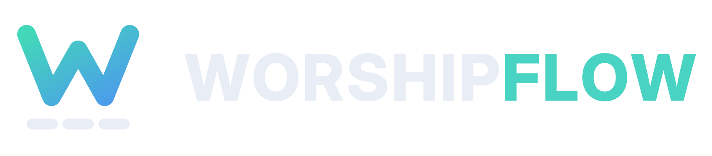
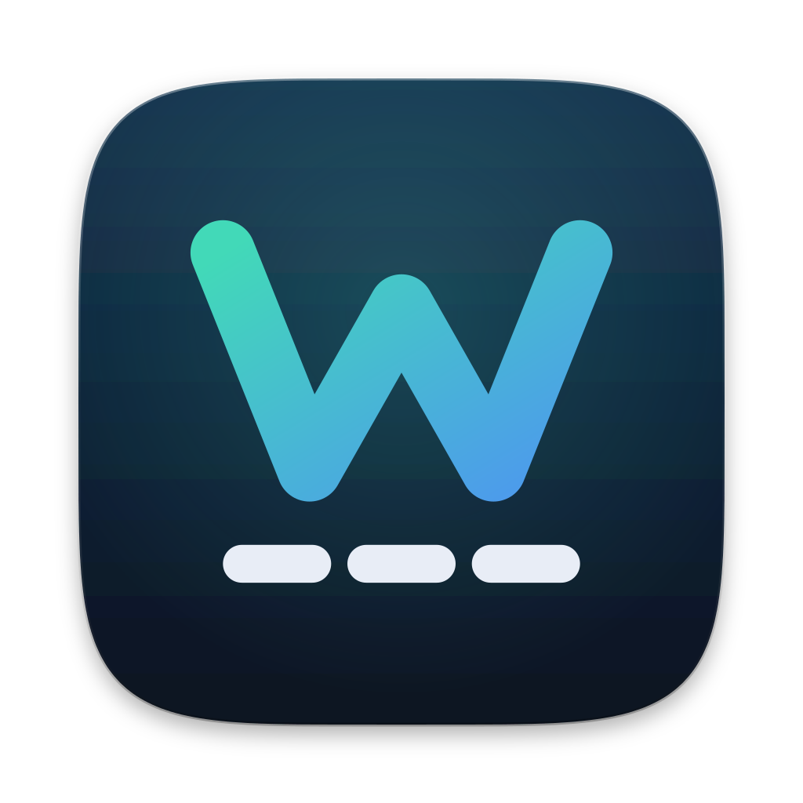
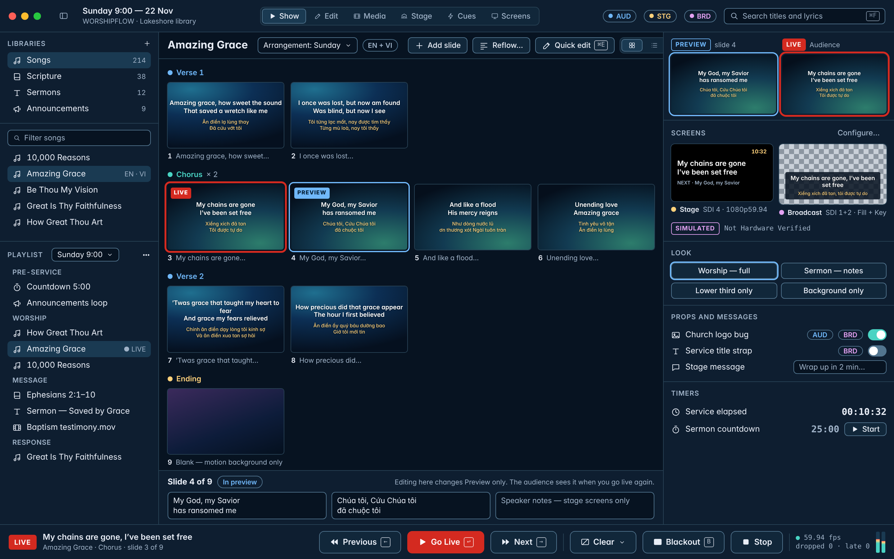
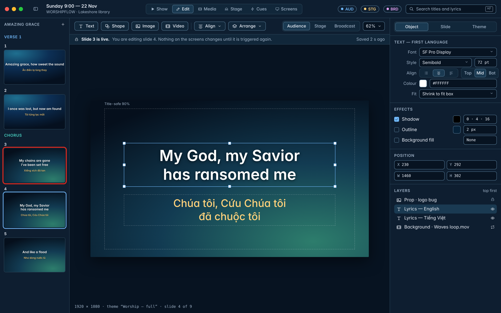
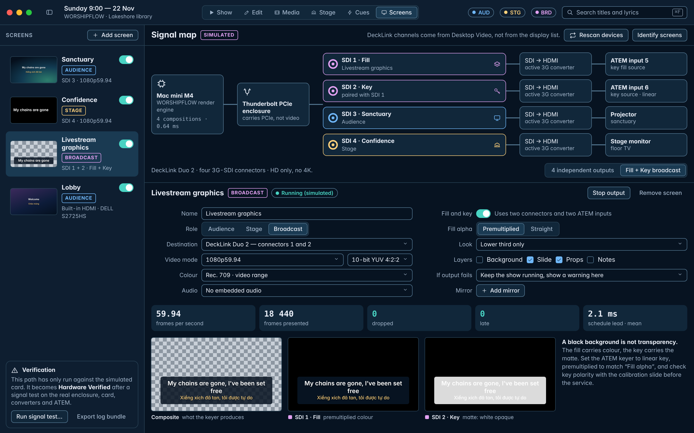
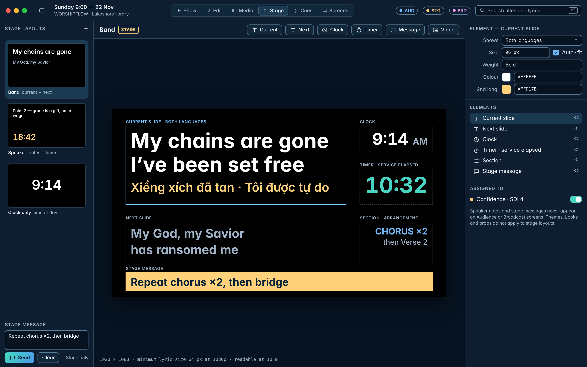
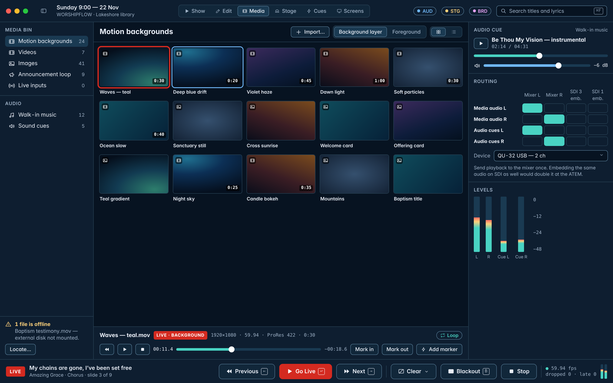
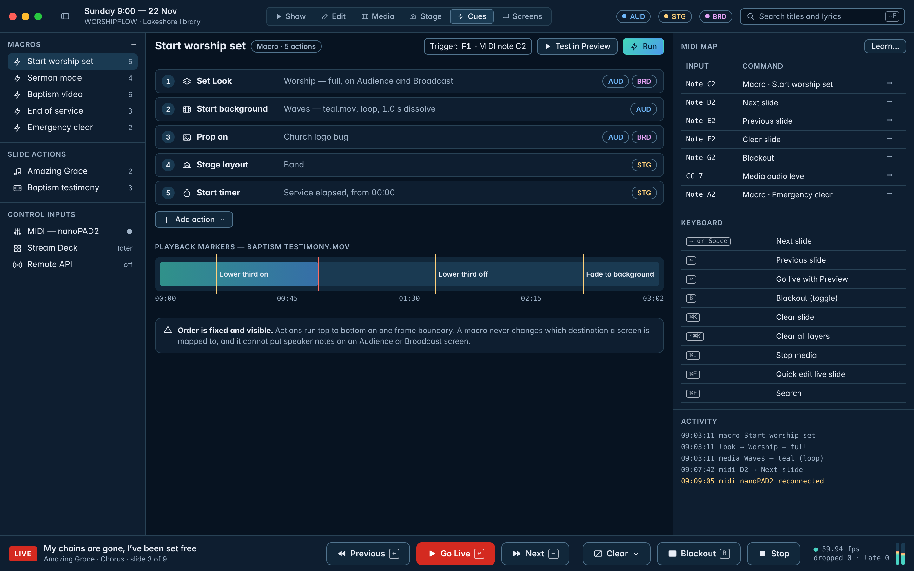
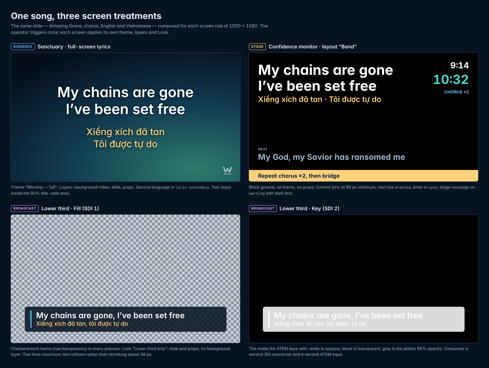
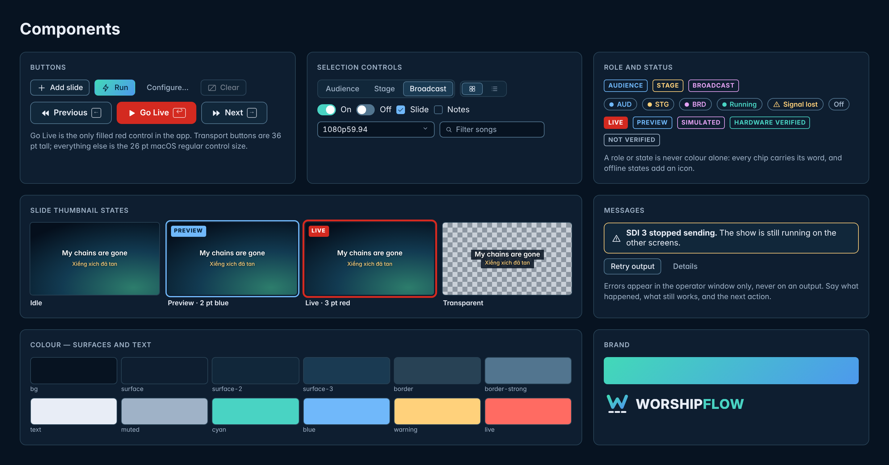

# WORSHIPFLOW — UI design

Design reference for the native macOS operator app: identity, tokens, screens and component rules. Source specification: `WORSHIPFLOW_Complete_Research_Guide.html` (feature catalog, hardware path, output scenarios) read together with `CLAUDE.md` and the current SwiftUI workspace (`App/Sources`, screenshots in `AI/reports`).

**Status: design only.** Nothing here is implemented, tested or hardware verified by virtue of being drawn. The mockups in `mockups/` are HTML used to produce the pictures in `screens/`; they are not app code and must not be embedded in the app (native SwiftUI/AppKit only). Screens that show DeckLink, ATEM or fill/key behaviour illustrate intended UI, not a verified signal path.

## What is in this folder

| Path | Contents |
|---|---|
| `logo/` | Mark, wordmark and lockups as SVG (plus PNG exports of the main ones) |
| `icon/` | macOS app icon: 1024 master (SVG, PNG), `AppIcon.iconset/` at every macOS size, `AppIcon.icns`, and `layers/` for Icon Composer |
| `screens/` | Rendered screens at 2880 × 1800 (a 1440 × 900 pt window at 2×) and two boards |
| `mockups/` | HTML/CSS sources of the screens. Open any file in a browser; add `?theme=light` for the light theme |
| `design-tokens.json` | Colour (dark and light), type, spacing, radius and shadow tokens with usage notes |

## Identity

**The mark** is a W drawn as one continuous round-capped stroke — the flow of a service — over three bars: the three screen roles every slide is composed for (Audience, Stage, Broadcast). The stroke carries the brand gradient from the research guide, `#42D9B8 → #4D99ED` at 135°.

**The wordmark** is WORSHIPFLOW in capitals, one word, with FLOW in the accent colour. It is outlined from Inter Display ExtraBold (SIL Open Font License), so no font is needed to render it. In running text write WORSHIPFLOW in capitals with no space.

| File | Use on |
|---|---|
| `worshipflow-logo-horizontal-on-dark.svg` | Dark grounds: About window, splash, documents |
| `worshipflow-logo-horizontal-on-light.svg` | Light grounds; uses the darker gradient `#047F75 → #125FA6` |
| `worshipflow-logo-stacked-on-dark.svg` | Square spaces |
| `worshipflow-mark-on-dark.svg`, `-on-light.svg` | The mark alone |
| `worshipflow-mark-mono-white.svg`, `-mono-ink.svg` | Single ink: watermark on an output, print, menu bar template |
| `worshipflow-wordmark-on-dark.svg`, `-on-light.svg` | The wordmark alone |

Rules: keep clear space of one bar-width around the mark; minimum mark height 16 pt (below that use the icon's small variant, which drops the bars); do not recolour the gradient, add effects, or set the wordmark in another typeface. Single-ink files have a fixed fill — an `` cannot inherit colour.

### App icon

The mark on a deep navy body (`#16344F → #071321`), on the macOS icon grid: 1024 canvas, 824 body with continuous corners, soft drop shadow. `AppIcon-small.svg` is the optical variant for 16 and 32 px — a heavier W without the bars — and is what the 16/32 px files in the iconset are rendered from.

To install the classic way, add `icon/AppIcon.iconset` contents to `Assets.xcassets/AppIcon.appiconset` (the app currently has an empty `App/Resources`), or reference `AppIcon.icns` directly. For the layered icon format in current Xcode, `layers/glyph-foreground.svg` is the foreground layer and `layers/background.svg` gives the background fill; build the `.icon` in Icon Composer from those two. That step has not been done here and needs a Mac with Xcode.

## Design principles

1. **Live is unmistakable.** One colour means on-air: `live`. The Go Live button, the LIVE tag and the 3 pt ring on a thumbnail are the only filled red in the app. Preview is always the blue ring. Nothing else may use either.
2. **Every output is visible and named.** The operator can always see which composition is going to which destination. Role chips (AUD, STG, BRD) sit in the toolbar in every mode; every preview is captioned with its connector and video mode.
3. **Dark by default, booth-safe.** The operator sits in a dim room. Dark navy surfaces, no large bright fields, no animation that pulls the eye away from the stage. A light theme is fully specified for daytime preparation.
4. **Keyboard first.** Every transport action has a visible key hint. The slide grid holds focus by default; text fields never trap the arrow keys during a show.
5. **Honest status.** Verification level is shown in the product, not hidden in docs: `Simulated`, `Hardware Verified`, `Not Verified` are real badges. A simulated card never reads as a real one.
6. **Never colour alone.** A role or state always carries a word or icon. Healthy status is cyan rather than green, so it never has to be told from red by hue.
7. **Native.** Standard macOS window, unified toolbar, sidebar, inspector, sheets, menus and SF Symbols. The tokens tint system controls; they do not replace them.

## Window anatomy

One window, sized for 1440 × 900 pt minimum comfortable, 1100 × 640 pt hard minimum (matches the existing `ContentView` frame).

| Region | Size | Contents |
|---|---|---|
| Toolbar | 52 pt | Sidebar toggle, service title, **mode switcher**, output chips, search (⌘F) |
| Sidebar | 256 pt (240–380) | Libraries, library items, playlist |
| Centre | flexible, ≥ 460 pt | The mode's main surface |
| Inspector | 372 pt (320–440) | Preview and Live monitors, screens, Look, props, timers — or the mode's inspector |
| Transport bar | 56 pt | Live state and current line, Previous / Go Live / Next, Clear, Blackout, Stop, frame health, audio meters |

The mode switcher is a segmented control with six modes. **Show**, **Media** and **Cues** keep the transport bar; **Edit**, **Stage** and **Screens** are preparation modes and drop it to give the canvas room, but the toolbar chips still show what is live.

## Screens

### 1. Show — operator workspace (`OUT-004`, `LIB`, `CUE`)

The existing workspace, reorganised. Slides are grouped by section with coloured labels; the playlist gains headers (Pre-service, Worship, Message, Response). Preview and Live sit side by side at the top of the inspector so the operator compares them at a glance, with Stage and Broadcast thumbnails beneath. Looks are four large buttons, not a pop-up. The quick-edit strip under the grid states plainly that it edits Preview only.

Light theme: `screens/09-operator-show-light.png`.

### 2. Edit — slide editor (`SLIDE`)

Filmstrip, canvas, inspector. A strip above the canvas says which slide is live and that edits do not reach the screens until re-triggered. The canvas shows the 90% title-safe guide. The Audience / Stage / Broadcast control previews the same slide under each screen's theme. Layers are listed top first, with the prop and background layers shown but locked from this editor.

### 3. Screens — outputs and signal map (`OUT`, `HW`, `KEY`)

The signal map draws the real path — Mac → Thunderbolt enclosure → DeckLink connectors → converters → destinations — so wiring mistakes are visible. Connectors are tiles coloured by role; a fill/key pair shows both connectors in the Broadcast colour with a layers icon and a key icon. The form sets everything the hardware rules require: device and connectors, video mode, pixel format, colour, audio, fill alpha, failure behaviour. The bottom row previews composite, fill and key separately. The Verification card states the current level and offers the signal test.

Light theme: `screens/11-screens-outputs-light.png`.

### 4. Stage — stage layout editor (`STAGE`)

Layouts on the left, a 1080p canvas with labelled elements (current, next, clock, timer, section, message), element inspector on the right. Stage message composer lives here and is also reachable from the Show inspector. The inspector repeats the privacy rule: notes and messages never reach Audience or Broadcast.

### 5. Media — bin, transport and audio (`MEDIA`)

Media bin grid with kind and duration on each tile, the same Preview/Live rings as slides, a transport strip with in/out and markers, and an audio panel with cue player, routing matrix, device choice and levels. Offline media is called out in the sidebar with a Locate action.

### 6. Cues — macros, slide actions, control inputs (`CUE`)

A macro is an ordered, numbered list of actions, each showing which screens it touches. Playback markers sit on a clip timeline. MIDI and keyboard maps are plain tables. Stream Deck, Remote API and other integrations appear as rows marked later/off — they are later milestones and are drawn only as placeholders.

### 7. Output compositions

One slide on each role. Audience: centred lyrics over motion. Stage: black ground, large current line, next line, clock, timer, message bar. Broadcast: lower third on true transparency, with its key matte.

### 8. Components

Light theme: `screens/10-components-light.png`.

## Semantics the UI must keep

| Action | Key | Effect |
|---|---|---|
| Select slide | click, arrows | Changes **Preview** only |
| Go Live | ↩ | Sends Preview to all enabled screens |
| Next / Previous | → or Space / ← | Steps live; continues across playlist items |
| Clear | ⌘K (slide), ⇧⌘K (all) | Removes the chosen layer(s); background can stay |
| Blackout | B | Toggle. Black on Audience and Stage; **transparent, not black**, on Broadcast |
| Stop | ⌘. | Stops media playback; slides stay |
| Quick edit | ⌘E | The one edit that changes the live slide |
| Search | ⌘F | Titles and lyrics, diacritics ignored |

Errors appear in a bar inside the operator window and never on an output. Each says what happened, what still works and the next action: “SDI 3 stopped sending. The show is still running on the other screens.”

## Tokens

Full list with usage notes: `design-tokens.json`. Dark is the primary theme.

| Token | Dark | Light | Role |
|---|---|---|---|
| `bg` | `#071321` | `#F5F8FB` | Window ground |
| `surface` | `#0E1E30` | `#FFFFFF` | Toolbar, sidebars, cards |
| `surface-2` | `#11273A` | `#ECF4FB` | Resting controls |
| `surface-3` | `#1A3A52` | `#D9E8F5` | Selection |
| `border` | `#284255` | `#D7E1EC` | Dividers |
| `border-strong` | `#52758F` | `#6C8198` | Control outlines |
| `text` | `#E8EDF6` | `#13283D` | Primary text |
| `muted` | `#9FB2C7` | `#536A80` | Secondary text |
| `cyan` | `#49D3C3` | `#047F75` | Healthy, on, timers |
| `blue` | `#70B8FA` | `#125FA6` | Preview, Audience |
| `warning` | `#FFD17B` | `#995B00` | Stage, warnings |
| `live` / `live-fill` | `#FF6B62` / `#D42A20` | `#C8281F` | On-air text / fill |
| `broadcast` | `#E3A1F2` | `#8A2FA3` | Broadcast, fill/key |
| `brand-a` → `brand-b` | `#42D9B8` → `#4D99ED` | same | Brand gradient |

The surface, text, cyan, blue and warning values are the research guide's own palette. Added for the app: `surface-3`, `border-strong`, `live`, `live-fill`, `broadcast`.

**Contrast (checked by calculation, WCAG 2).** Dark: `text` ≥ 10:1 and `muted` ≥ 5.5:1 on all four surfaces; `border-strong` ≥ 3.1:1 on `bg`, `surface`, `surface-2`; white on `live-fill` 5.1:1. Light: `text` ≥ 12:1, `muted` ≥ 4.5:1; `border-strong` ≥ 3.4:1. Two pairs to respect: `live` text is below 4.5:1 on `surface-3` in both themes, and light-theme `cyan` (the guide's value) is 4.4:1 on `surface-2` — keep those off those surfaces or set them semibold.

**Type.** San Francisco throughout (SF Pro Text/Display, SF Mono) via the system font — it covers Vietnamese and the other scripts the library will hold. The mockups are rendered with Inter as a stand-in, so letter widths differ slightly from the real app. Operator sizes follow macOS text styles (`body` 13/16, `title2` 17/22, section labels 11 pt semibold uppercase). Numbers that change (timers, frame counters) use monospaced digits. Output sizes at 1080p: lyrics 120 px, second language 80 px, lower third 68 px (never below 56), stage current 128 px (auto-fit floor 96), stage next 72 px (floor 64).

**Spacing and shape.** 2, 4, 8, 12, 14, 24, 32. Controls 26 pt, transport buttons 36 pt. Radii 3 (tags), 4 (thumbnails), 6 (controls), 8 (transport, tiles), 10 (cards, sheets). Only sheets, popovers and the editor canvas cast a shadow.

## Iconography

SF Symbols in the app; the mockups use simple line stand-ins. Suggested symbols — check each name in the SF Symbols app before use, since availability varies by macOS version:

| Meaning | Symbol |
|---|---|
| Songs / Scripture / Sermons / Announcements | `music.note` · `book` · `text.alignleft` · `megaphone` |
| Media video / image | `film` · `photo` |
| Audience / Stage / Broadcast | `display` · `music.mic` · `dot.radiowaves.left.and.right` |
| Fill / Key | `square.stack.3d.up` · `key` |
| Previous / Go Live / Next / Stop | `backward.fill` · `play.fill` · `forward.fill` · `stop.fill` |
| Clear / Blackout | `rectangle.slash` · `rectangle.fill` |
| Macro / MIDI / Timer / Clock | `bolt` · `slider.vertical.3` · `timer` · `clock` |
| Warning / Offline | `exclamationmark.triangle` |

## Building it in SwiftUI

- Put the colours in the asset catalog as named colour sets with Any/Dark appearances (`Color("surface")`), not as literals. Output colours (`canvas`, `lyric-ink`, `lyric-ink-2`, `plate`) are render-engine constants and do not follow the operator's appearance.
- Mode switcher: `Picker` with `.segmented` in a `ToolbarItem(placement: .principal)`. Sidebar and inspector: the existing `NavigationSplitView` plus `.inspector`, or keep `HSplitView`.
- Use regular control size for everything except the transport bar (`.controlSize(.large)`). The Go Live button is `.borderedProminent` tinted `live-fill`.
- Thumbnail rings are overlays outside the image (2 pt offset) so they never cover lyric text.
- Transparent previews draw the checkerboard already in `Thumbnails.swift`; use it for every Broadcast preview so a black background is never mistaken for transparency.
- Role chips and status pills should expose their text to VoiceOver; the dot is decorative.
- The signal map is a custom `Canvas` or `Grid` view; connector tiles are data-driven from device discovery and must not hard-code connector order.

## Coverage against the research guide

| Guide section | Where it is designed | Not drawn (later milestone) |
|---|---|---|
| Presentation & worship (13) | Show, Edit: editor, libraries, playlists, arrangements, reflow, themes, quick edit, search, two languages | Bible integration UI beyond a library row, song services, planning integrations, cloud workspace |
| Media, video & audio (12) | Media: bin, backgrounds, foreground, audio library, routing, props, messages, announcements | Live video inputs (row only), masks, network streams |
| Screens & video outputs (13) | Screens, output board: independent outputs, roles, mirror, Looks, alternate themes, fill/key, DeckLink SDI | Grouped displays, edge blending, NDI, Syphon |
| Automation & control (14) | Cues: slide actions, macros, MIDI in, playback markers | MIDI out, DMX, timecode, timeline, Stream Deck, remote API, linking, calendar, web control |
| Live production & streaming (12) | Stage editor, current/next, stage messages, timers, preview surfaces, operator workspace, live editing | Recording, RTMP, resilient streaming, media subscriptions, team collaboration |
| Hardware and troubleshooting | Screens: signal map, verification card, failure behaviour, health counters | A guided troubleshooting flow |

## Open decisions

- Whether Stage and Screens stay as full modes or become sheets, as they are in the app today (`StageEditorSheet`, the Screens panel). The modes give the signal map and stage canvas the room they need; sheets are less code.
- Section colours are fixed per section type here. The app already stores a colour per section; decide whether users may override.
- The layered `.icon` file has not been built.
